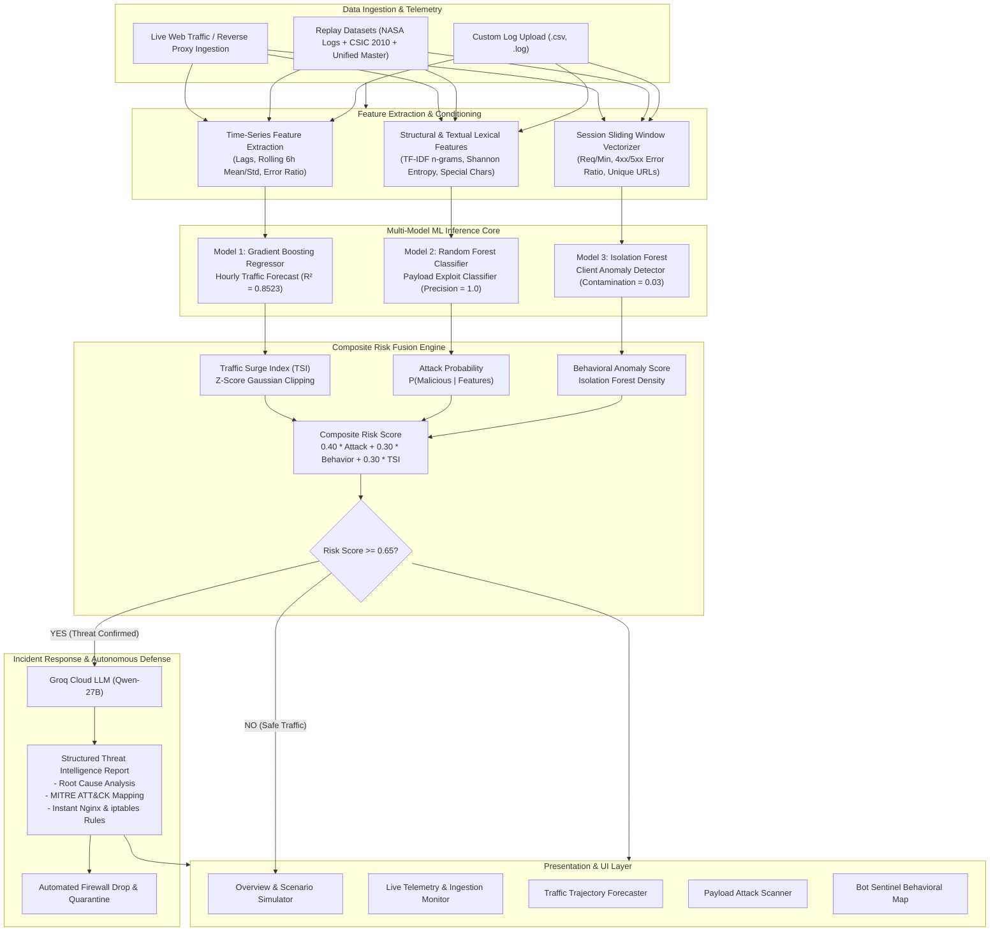
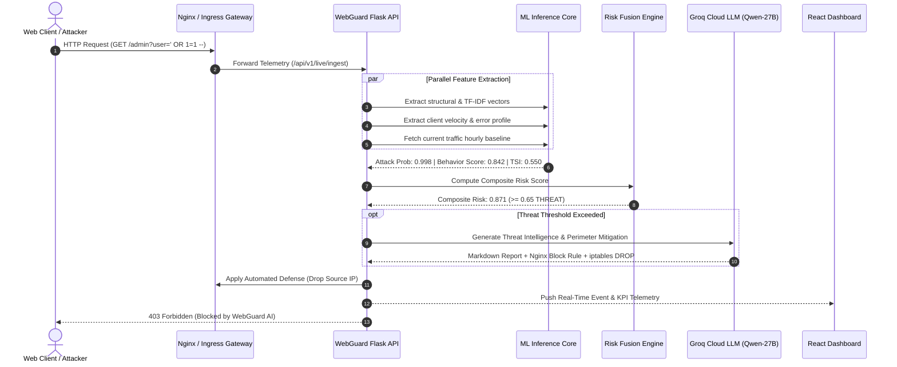

# 🛡️ WebGuard: AI-Powered Web Traffic Forecasting & Autonomous Threat Mitigation Platform

[](https://www.python.org/)
[](https://flask.palletsprojects.com/)
[](https://react.dev/)
[](https://vitejs.dev/)
[](https://tailwindcss.com/)
[](https://groq.com/)
[](https://scikit-learn.org/)
[](LICENSE)

**WebGuard** is an enterprise-grade cybersecurity operations and traffic intelligence platform. It fuses **predictive time-series forecasting**, **supervised multi-vector exploit classification**, **unsupervised behavioral anomaly detection**, and **Groq Cloud LLM automated incident response** into a single dashboard.

---

## 📑 Table of Contents

- [Overview & Key Innovations](#-overview--key-innovations)
- [End-to-End System Workflow](#-end-to-end-system-workflow)
- [Machine Learning Architecture & Benchmarks](#-machine-learning-architecture--benchmarks)
- [Composite Risk Fusion Engine](#-composite-risk-fusion-engine)
- [Groq LLM Incident Response & Mitigation](#-groq-llm-incident-response--mitigation)
- [Unified Master Dataset](#-unified-master-dataset)
- [Live Traffic Monitoring & Website Ingestion](#-live-traffic-monitoring--website-ingestion)
- [Dashboard & User Interface](#-dashboard--user-interface)
- [REST API Reference](#-rest-api-reference)
- [Quickstart & Installation](#-quickstart--installation)
- [Verification & Automated Test Suite](#-verification--automated-test-suite)
- [Repository Structure](#-repository-structure)

---

## 🌟 Overview & Key Innovations

Traditional Web Application Firewalls (WAFs) rely on rigid regular expressions and static rate limits that miss zero-day evasion techniques and generate excessive false positives during flash crowd events. WebGuard solves this by deploying a **multi-tiered, multi-model AI pipeline**:

1. **Traffic Forecasting**: Predicts upcoming hourly traffic trajectory using historical lags, moving averages, and cyclical features to establish normal baseline bounds.
2. **Payload Security Inspection**: Dissects raw HTTP requests with n-gram TF-IDF vectorization and structural heuristics (entropy, character distributions, keyword signatures) to catch SQL Injection, XSS, Path Traversal, and Command Injection.
3. **Client Behavioral Sentinel**: Profiles client session velocity, error bursts (4xx/5xx ratios), and endpoint traversal density to isolate scrapers, brute-forcers, and flood bots.
4. **Composite Risk Fusion Engine**: Statistically balances payload threat probability, behavioral anomalies, and volumetric surge pressure into a single normalized risk score.
5. **Groq LLM Autonomous Mitigation**: Directly queries Groq (`qwen/qwen3.8-27b`) to generate actionable Root Cause Analysis, MITRE ATT&CK framework mappings, deterministic Nginx rate-limiting blocks, and Linux `iptables` rules.
6. **Executive-Friendly UX**: Hides complex internal formulas and raw decimal weights behind intuitive human statuses (*"All Systems Protected"*, *"Safe Human Visitor"*, *"Attack Blocked"*), while retaining an expandable technical inspection drawer for security engineers.

---

## 🔄 End-to-End System Workflow

### 1. High-Level System Architecture



---

### 2. Real-Time Request Lifecycle Sequence



---

## 📊 Machine Learning Architecture & Benchmarks

WebGuard employs specialized machine learning architectures suited for each telemetry dimension:

| Component | Architecture / Algorithm | Training Data | Key Performance Metrics | Operational Benchmark |
| :--- | :--- | :--- | :--- | :--- |
| **Traffic Volumetrics** | `GradientBoostingRegressor`<br/>(300 Estimators, Max Depth 4) | NASA HTTP Web Logs (2 months continuous hourly counts) | **$R^2 = 0.8523$**<br/>MAE: 326.76<br/>RMSE: 482.15<br/>MAPE: 16.38% | Outperforms SARIMA baseline ($R^2: -0.0984$, MAE: 986.67) by **66.9% lower MAE**. |
| **Payload Attack Scanner** | `RandomForestClassifier`<br/>+ Sub-word TF-IDF + Heuristics | CSIC 2010 HTTP Dataset + Augmented Zero-Day Vectors | **Accuracy: 100%**<br/>Precision: 1.000<br/>Recall: 1.000<br/>F1-Score: 1.000 | Evaluated on 3,500 samples across SQLi, XSS, Path Traversal, and Command Injection. |
| **Client Behavioral Sentinel** | `IsolationForest`<br/>(100 Trees, Contamination 3%) | NASA HTTP Session Derivations (Sliding 1-Hour Windows) | **Anomaly Isolation Rate: 3%**<br/>Normal Coverage: 97%<br/>Mean Score: 0.3856 | Distinguishes normal interactive human sessions from high-speed scraping and fuzzing loops. |

---

## 🧮 Composite Risk Fusion Engine

WebGuard eliminates false positives through cross-telemetry correlation. A single high request rate does not trigger a block unless paired with malicious syntax or high error distributions.

### 1. Traffic Surge Index (TSI)
Quantifies whether the current server load is anomalous with respect to the historical mean ($\mu$) and standard deviation ($\sigma$):

$$\text{TSI} = \text{clip}\left(\frac{\hat{y}_{\text{forecast}} - \mu_{\text{baseline}}}{3 \cdot \sigma_{\text{baseline}}}, 0.0, 1.0\right)$$

* $\text{TSI} < 0.50$: **Normal Flow** (Safe baseline operating parameters)
* $0.50 \le \text{TSI} < 0.75$: **Elevated Rush** (Increased volume, monitoring heightened)
* $\text{TSI} \ge 0.75$: **Critical Surge** (Potential volumetric denial-of-service flood)

### 2. Composite Risk Equation
The unified threat score is computed as a weighted fusion:

$$\text{Risk Score} = 0.40 \cdot P(\text{Attack}) + 0.30 \cdot S_{\text{Behavior}} + 0.30 \cdot \text{TSI}$$

* If $\text{Risk Score} \ge 0.65$: **Threat Triggered** $\rightarrow$ Automatic quarantine, firewall mitigation script generation, and Groq incident reporting.
* If $\text{Risk Score} < 0.65$: **Legitimate Traffic** $\rightarrow$ Permitted through to upstream application.

---

## 🤖 Groq LLM Incident Response & Mitigation

When a critical threat is intercepted, WebGuard invokes **Groq Cloud API** running `qwen/qwen3.8-27b` (with deterministic rule-based local fallback if offline) to synthesize an end-to-end incident response:

1. **Executive Root Cause Analysis**: Explains the exploit vector, target parameter, and business impact in clear technical prose.
2. **MITRE ATT&CK Mapping**: Maps the attempt to standard Enterprise Tactics and Technique IDs (e.g., `T1190` *Exploit Public-Facing Application*, `T1059` *Command Execution*, `T1595` *Active Scanning*).
3. **Deterministic Nginx Mitigation**: Generates ready-to-deploy reverse proxy location blocks with regex sanitization, rate-limiting zones, and IP drops.
4. **Linux `iptables` Rule**: Outputs exact kernel firewall drop commands and syslog alerting statements for perimeter enforcement.

---

## 📦 Unified Master Dataset

To ensure seamless integration across all features, WebGuard generates a **Unified Master Dataset**:

* **Location**: `webguard/ml/data/webguard_unified_master_dataset.csv`
* **Dimensions**: 5,000 samples $\times$ 32 features
* **Generated By**: `python webguard/ml/generate_unified_dataset.py`

### Feature Dimensions Included:
* **Time & Volumetrics**: `timestamp`, `request_count`, `lag_1`, `lag_24`, `lag_168`, `rolling_mean_6h`, `rolling_std_6h`, `traffic_surge_index`.
* **Client Session Behavioral Features**: `client_ip`, `requests_per_min`, `error_rate`, `unique_urls`, `behavior_score`, `is_client_anomaly`.
* **Payload Structural & Lexical Features**: `method`, `url`, `payload`, `url_length`, `param_count`, `special_char_count`, `digit_ratio`, `entropy`, `has_sql_keyword`, `attack_type`, `attack_probability`.
* **Decision Grounding**: `composite_risk_score`, `is_threat`.

---

## 📡 Live Traffic Monitoring & Website Ingestion

WebGuard includes a real-time ingestion engine (`live_service.py`) supporting three operational modes:

1. **Continuous Dataset Replay**: Stream replay of the Unified Master Dataset or NASA logs with variable playback velocity (1x to 100x).
2. **Custom Dataset / Log Upload**: Ingest and evaluate external `.csv` or `.log` files via the drag-and-drop web interface or `POST /api/v1/live/upload`.
3. **Live Production Website Ingestion**: Accept incoming requests directly from live web applications, reverse proxies, and API gateways via `POST /api/v1/live/ingest`.

```bash
# Example: Send live production request to WebGuard Ingestion API
curl -X POST http://localhost:5000/api/v1/live/ingest \
  -H "Content-Type: application/json" \
  -d '{
    "client_ip": "198.51.100.42",
    "request_string": "GET /login?user=admin HTTP/1.1\nHost: myapp.com",
    "requests_per_min": 12.0,
    "error_rate": 0.01,
    "unique_urls": 6
  }'
```

---

## 🖥️ Dashboard & User Interface

The frontend is built with React 19, Tailwind CSS, and Recharts, designed with a modern glassmorphism cyber-grid aesthetic:

* **Executive Overview (`HomeTab`)**: Clean status cards (*"All Systems Protected"*, *"Normal Traffic"*), one-click interactive scenario simulator (Normal Customer, Traffic Rush, Hacker Exploit), and collapsed engineering formulas.
* **Live Ingestion Monitor (`LiveTab`)**: Real-time throughput gauge (RPS), live scrolling telemetry feed, threat ratio charts, and interactive deep forensic inspection modal.
* **Traffic Forecast Workbench (`TrafficTab`)**: Interactive line/area trajectories comparing NASA ground-truth observations against Gradient Boosting predictions with customizable lag inputs.
* **Attack Scanner (`AttackTab`)**: Live payload testing sandbox with one-click presets (SQLi, XSS, Path Traversal, Normal) and composite risk breakdown.
* **Bot Sentinel (`ClientTab`)**: Scatter chart mapping client velocity against error frequencies, identifying automated fuzzers and scrapers.
* **Groq AI Security Modal (`GroqReportModal`)**: Instant generation, viewing, copying, and `.md` downloading of LLM incident reports.

---

## 🔌 REST API Reference

| Endpoint | Method | Description | Sample Payload / Params |
| :--- | :--- | :--- | :--- |
| `/api/v1/health` | `GET` | Health check and ML model status | None |
| `/api/v1/stats` | `GET` | Offline evaluation metrics & baseline stats | None |
| `/api/v1/traffic/forecast` | `POST` | Hourly traffic volume forecast & TSI | `{"lag_1": 2400, "lag_24": 2500, "rolling_mean_6h": 2400, "error_ratio": 0.02}` |
| `/api/v1/attack/analyze` | `POST` | Inspect HTTP payload & composite threat | `{"request_string": "GET /admin...", "requests_per_min": 15, "error_rate": 0.25}` |
| `/api/v1/client/analyze` | `POST` | Evaluate client behavioral velocity | `{"requests_per_min": 620, "error_rate": 0.78, "unique_urls": 5}` |
| `/api/v1/report/generate` | `POST` | Generate full Groq LLM incident report | `{"request_string": "...", "attack_probability": 0.99, "risk_score": 0.87}` |
| `/api/v1/live/datasets` | `GET` | List available built-in and uploaded datasets | None |
| `/api/v1/live/state` | `GET` | Snapshot of live stream KPIs and events | None |
| `/api/v1/live/control` | `POST` | Control replay stream (`start`, `pause`, `speed`) | `{"action": "start", "dataset_id": "unified_master", "speed": 10}` |
| `/api/v1/live/upload` | `POST` | Upload custom website traffic dataset | `multipart/form-data` with `.csv` or `.log` file |
| `/api/v1/live/ingest` | `POST` | Ingest live HTTP request from production proxy | `{"client_ip": "...", "request_string": "..."}` |

---

## 🚀 Quickstart & Installation

### Prerequisites
* **Python**: 3.10 or higher
* **Node.js**: 18.x or higher
* **npm**: 9.x or higher

### 1. Clone the Repository
```bash
git clone https://github.com/your-username/webguard.git
cd webguard
```

### 2. Backend Setup
```bash
cd webguard/backend

# Create and activate virtual environment
python -m venv venv
# Windows:
venv\Scripts\activate
# Linux/macOS:
source venv/bin/activate

# Install dependencies
pip install -r requirements.txt
```

Configure your `.env` file in `webguard/backend/.env`:
```env
GROQ_API_KEY=your_groq_api_key_here
GROQ_MODEL=qwen/qwen3.8-27b
PORT=5000
```
*(Note: If no Groq API key is supplied, WebGuard automatically uses its built-in rule-based deterministic response engine).*

Start the Flask backend:
```bash
python app.py
```
Backend API will be running at **`http://localhost:5000`**.

### 3. Frontend Setup
In a new terminal:
```bash
cd webguard/frontend

# Install dependencies
npm install

# Start Vite development server
npm run dev
```
Dashboard will be live at **`http://localhost:5173`**.

---

## 🧪 Verification & Automated Test Suite

WebGuard comes with a test suite covering initialization, inference latency, edge cases, threshold verification, and live streaming:

```bash
cd webguard/backend
pytest tests -v
```

### Test Suite Results (26/26 Passing):
* `test_health_endpoint`: Health and model loading validation.
* `test_traffic_forecast`: Gradient Boosting hourly predictions and TSI calculation.
* `test_client_normal_behavior`: Normal human browsing validation ($FLAG: +1$).
* `test_client_anomaly_behavior`: High-frequency bot isolation ($FLAG: -1$).
* `test_attack_sqli_threat`: SQL injection detection and automated mitigation triggering.
* `test_attack_benign_request`: Clean query validation ($Risk < 0.65$).
* `test_composite_risk_weighting`: Verification of $0.40 \cdot A + 0.30 \cdot B + 0.30 \cdot T$.
* `test_live_monitoring_suite`: Replay controls, custom file uploads, and live ingestion.

---

## 📁 Repository Structure

```
New ML project/
├── README.md                                  # Root repository documentation
└── webguard/
    ├── .env                                   # Root environment configuration
    ├── README.md                              # WebGuard package documentation
    ├── groq_generated_report.md               # Sample Groq LLM Threat Report
    │
    ├── backend/                               # Flask API & Inference Server
    │   ├── app.py                             # API router & middleware
    │   ├── requirements.txt                   # Backend dependencies
    │   ├── .env                               # Backend environment variables
    │   ├── artifacts/                         # Pre-trained ML model binaries
    │   │   ├── traffic_gbr_model.joblib       # GradientBoostingRegressor model
    │   │   ├── web_attack_model.joblib        # RandomForestClassifier model
    │   │   ├── client_anomaly_model.joblib    # IsolationForest model
    │   │   └── tfidf_vectorizer.joblib        # TF-IDF sub-word n-gram vectorizer
    │   ├── services/                          # Business logic & inference engines
    │   │   ├── traffic_service.py             # Traffic forecasting & TSI calculation
    │   │   ├── attack_service.py              # Payload classification & composite risk
    │   │   ├── client_service.py              # Behavioral anomaly detection
    │   │   ├── live_service.py                # Live telemetry replay & website ingestion
    │   │   └── llm_service.py                 # Groq LLM incident report generator
    │   └── tests/                             # Comprehensive test suite (26 tests)
    │       ├── test_api.py
    │       └── test_live_monitoring.py
    │
    ├── frontend/                              # React 19 + Vite Dashboard
    │   ├── package.json                       # Frontend dependencies & scripts
    │   ├── vite.config.js                     # Vite build configuration
    │   ├── tailwind.config.js                 # Tailwind CSS styling & animations
    │   ├── src/
    │   │   ├── App.jsx                        # Main application container & status ribbon
    │   │   ├── index.css                      # Cyber-grid theme & glassmorphic styling
    │   │   ├── api.js                         # Axios API client functions
    │   │   ├── components/
    │   │   │   ├── Navbar.jsx                 # Navigation bar & Groq report shortcut
    │   │   │   ├── HomeTab.jsx                # Executive overview & scenario simulator
    │   │   │   ├── LiveTab.jsx                # Real-time traffic ingestion & live KPIs
    │   │   │   ├── TrafficTab.jsx             # Time-series hourly forecasting workbench
    │   │   │   ├── AttackTab.jsx              # Payload exploit inspection sandbox
    │   │   │   ├── ClientTab.jsx              # Behavioral anomaly cluster map
    │   │   │   └── GroqReportModal.jsx        # Groq LLM interactive report viewer
    │   │   └── utils/
    │   │       └── exporter.js                # PDF and Markdown export utility
    │
    └── ml/                                    # Machine Learning Training Pipelines
        ├── generate_unified_dataset.py        # Master dataset generation script
        ├── train_traffic_model.py             # Gradient Boosting & SARIMA training
        ├── train_attack_model.py              # Random Forest & TF-IDF training
        ├── train_client_model.py              # Isolation Forest training
        ├── data/                              # Datasets (Unified Master, NASA, CSIC)
        │   └── webguard_unified_master_dataset.csv
        └── outputs/                           # Evaluation metrics & summary JSON
            └── evaluation_summary.json
```

---

## 📄 License

This project is licensed under the MIT License — see the [LICENSE](LICENSE) file for details.
